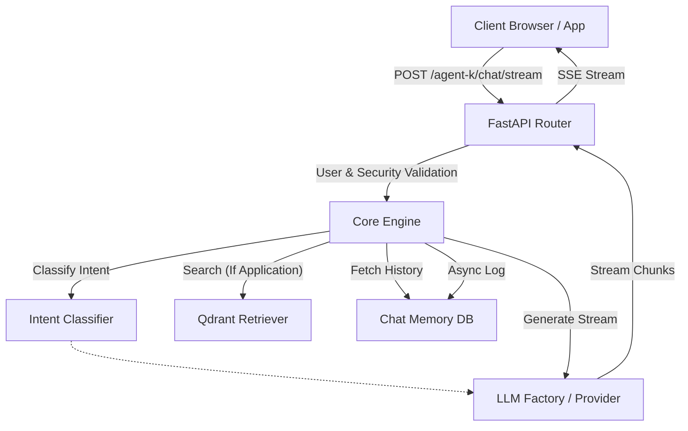
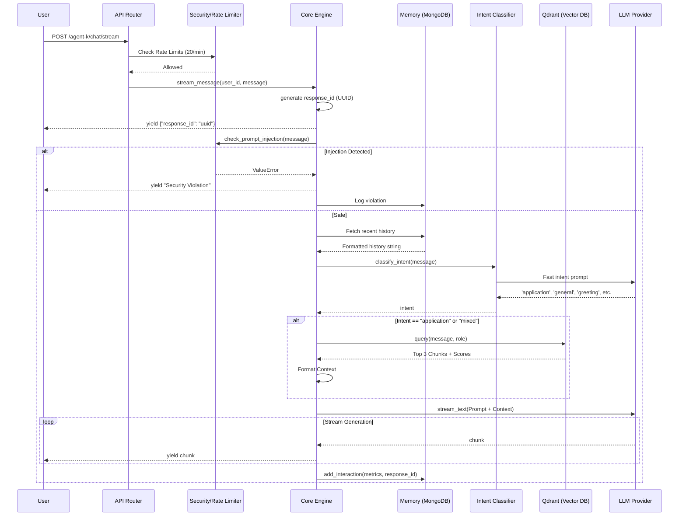

# Agent K Architecture

Agent K utilizes a modular architecture prioritizing speed, security, and accurate information retrieval.

## System Components

## Phase 3 Routing Logic (Sequence Diagram)

This diagram highlights how Agent K securely handles a streaming request, determines intent, and invokes RAG only when necessary to save on token usage and latency.

