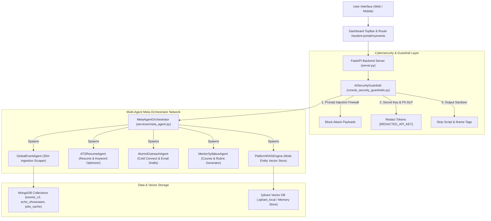

# Student Alumni Platform Architecture & Cybersecurity Documentation

This document provides a comprehensive technical overview of the **Platform-Wide RAG Engine**, **Multi-Agent Orchestration Network**, **Composite Cybersecurity & AI Guardrail Layer**, and **Development Standards**.

---

## 1. System Architecture Overview

---

## 2. Cybersecurity Composite Stack

Our security infrastructure combines **Guardrails AI** patterns, **Anthropic Defending-Code Harness** standards, **UK AISI Inspect** safety evals, and **Bandit** static analysis:

| Layer | Component | Implementation | Function |
| :--- | :--- | :--- | :--- |
| **Layer 1** | Real-Time AI Prompt Firewall | `AISecurityGuardrail.validate_prompt()` | Intercepts prompt injection (e.g. `"ignore previous instructions"`, `"bypass filters"`). |
| **Layer 2** | Data Loss Prevention (DLP) | `SECRET_PATTERNS` & `PII_PATTERNS` | Redacts API keys (`sk-...`), JWTs, GitHub tokens, Slack keys, SSNs, and emails. |
| **Layer 3** | Agent Context & Sandbox Isolation | `MetaAgentOrchestrator` | Prevents system prompt override and isolates agent execution. |
| **Layer 4** | Output XSS Protection | `AISecurityGuardrail.sanitize_output()` | Strips raw HTML `<script>` and `<iframe>` tags from AI outputs. |
| **Layer 5** | Static Code Security Scanner | `Bandit` | AST-level scanning for hardcoded credentials and shell injection flaws. |

---

## 3. Inventory of AI Agents

1. **Global Event Scraper Agent (`backend/services/event_agent.py`)**
   - Autonomous background scraper syncing open events, hackathons, workshops, and quizzes every 30 minutes into `echo_showcases` & `events_v2`.
2. **ATS Resume Builder Agent (`backend/services/resume_agent.py`)**
   - Evaluates candidate profiles against job postings, calculates ATS compatibility scores, and generates optimized bullet points.
3. **Alumni Outreach Agent (`backend/services/outreach_agent.py`)**
   - Drafts high-converting 300-char LinkedIn connect notes, cold emails, and coffee chat request scripts.
4. **Mentor Syllabus Agent (`backend/services/syllabus_agent.py`)**
   - Auto-generates multi-week workshop syllabi, learning objectives, capstone projects, and grading rubrics.
5. **Platform RAG Engine (`backend/services/platform_rag.py`)**
   - Multi-entity vector search indexing Jobs, Events, Courses, Mentors, Alumni, Deals, and Housing with Role-Based Access Control (RBAC).
6. **Meta-Agent Orchestrator (`backend/services/meta_agent.py`)**
   - Master agent that checks AI health availability and programmatically dispatches multi-agent workflows.

---

## 4. Development & Process Standards

All developers and agents contributing to this repository must follow `.agents/rules/development_standards.md`:

1. **Mandatory Unit Test Cases**: Every new service or agent feature must include unit tests under `backend/tests/` (100% pass rate mandatory).
2. **Explicit Debug Logging**: Every service must emit structured `logger.debug` metrics (request timing, byte payload size, match scores).
3. **Analytics Event Tracking**: Frontend views must include `trackScreen`, `trackClick`, and `track` calls.
4. **AI Model Availability Fallback**: Pre-check API keys (`EMERGENT_LLM_KEY`, `ANTHROPIC_API_KEY`, `OPENAI_API_KEY`) and provide graceful fallback data when keys are missing.
