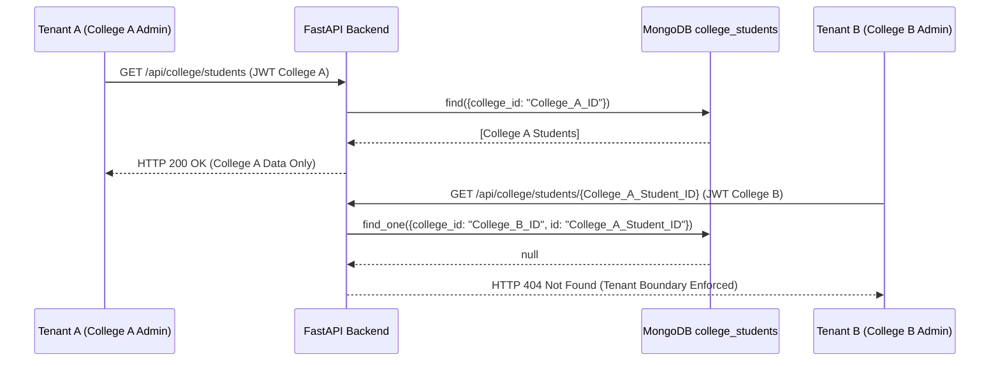

# Role-Based Access Control (RBAC) & Authorization Matrix
## Student Alumni SaaS Platform

**Document Version:** 1.0  
**Audit Reference:** SEC-AUD-2026-10-12  
**Target Environments:** `http://localhost:8081` (Frontend) & `http://localhost:8000` (Backend API)  

---

## 1. Persona & Role Definitions

| Role Identifier | Role Label | Description & Intended Capabilities | Primary Web Portal |
| :--- | :--- | :--- | :--- |
| `anonymous` | Guest / Visitor | Unauthenticated visitors; can view public landing pages, login, and registration. | `/login`, `/get-started` |
| `student` | Student | Active students; can access academic dashboard, job boards, mentors, events, and portfolio. | `/student-portal/*` |
| `alumni` | Alumni | Graduated students; can access alumni network, job postings, mentoring opportunities, and donations. | `/alumni-portal/*` |
| `mentor` | Mentor | Industry professionals & alumni mentors; can manage booking slots, mentee sessions, and reviews. | `/mentor-portal/*` |
| `college` | College / Tenant Admin | College administrators; manage student rosters, placement metrics, department analytics, and faculty. | `/college-portal/*` |
| `admin` / `super_admin` | Super Administrator | System-wide administrators; manage tenant colleges, users, AI agents, platform configurations, and system logs. | `/super-admin/*` |
| `vendor` | Partner / Vendor | Corporate hiring partners & event vendors; manage internships and job listings. | `/vendor-portal/*` |

---

## 2. Frontend Portal Route Authorization Matrix

| Route Path | Allowed Roles | Auth Required | Tenant Scoped | Guard Mechanism | Observed Runtime Access Behavior |
| :--- | :---: | :---: | :---: | :--- | :--- |
| `/login` | All / Anonymous | No | No | Public route | Loads login UI with Smart Email Detect. |
| `/get-started` | All / Anonymous | No | No | Public route | Registration wizard for students, alumni, mentors. |
| `/forgot-password` | All / Anonymous | No | No | Public route | Password reset entry point. |
| `/student-portal/*` | `student` | **Yes** | No | `app/student-portal/_layout.tsx` | Anonymous bounces to `/login`; Alumni/Mentors bounced to their own portals. Verified. |
| `/alumni-portal/*` | `alumni` | **Yes** | No | `app/alumni-portal/_layout.tsx` | Anonymous bounces to `/login`; Non-alumni redirected to respective portal. Verified. |
| `/mentor-portal/*` | `mentor` | **Yes** | No | `app/mentor-portal/_layout.tsx` | Anonymous bounces to `/login`; Students/Alumni redirected. Verified. |
| `/college-portal/*` | `college` | **Yes** | **Yes** | `app/college-portal/_layout.tsx` | Anonymous bounces to `/login`; Only college admins allowed. Verified. |
| `/super-admin/*` | `admin`, `super_admin` | **Yes** | No | `app/super-admin/_layout.tsx` | Anonymous bounces to `/login?redirect=/super-admin`; Students bounced back to `/student-portal`. Verified. |
| `/vendor-portal/*` | `vendor`, `admin` | **Yes** | No | `app/vendor-portal/_layout.tsx` | Anonymous bounces to `/login`. |

---

## 3. Backend API Authorization Matrix

### 3.1 Authentication & Onboarding Endpoints (`/api/auth/*`, `/api/users/*`)

| Endpoint | Method | Required Roles | Server Dependency | Tenant Bound | Expected vs Observed Runtime Status |
| :--- | :---: | :---: | :--- | :---: | :--- |
| `/api/auth/login` | `POST` | Anonymous | Public | No | **Observed: PASS**. Authenticates credentials; returns tokens or 2FA challenge. |
| `/api/auth/register` | `POST` | Anonymous | Public | No | **Observed: VULNERABLE (SEC-VULN-01)**. Accepts unauthenticated assignment of `admin`/`super_admin`. |
| `/api/auth/check-email` | `GET` | Anonymous | Public | No | **Observed: DEFECT (SEC-DEFECT-01)**. Exposes full name and role without authentication. |
| `/api/auth/refresh` | `POST` | Anonymous | Public (Valid Refresh JWT) | No | **Observed: PASS**. Exchanges valid refresh token; rejects invalid/expired tokens with 401. |
| `/api/auth/me` | `GET` | Authenticated | `Depends(get_current_user)` | No | **Observed: PASS**. Requires valid Bearer JWT; returns user document. |
| `/api/auth/logout` | `POST` | Authenticated | `Depends(get_current_user)` | No | **Observed: PASS**. Revokes active push notifications and session tokens. |
| `/api/auth/2fa/setup` | `POST` | Authenticated | `Depends(get_current_user)` | No | **Observed: PASS**. Generates TOTP secret and QR code for authenticated user. |
| `/api/auth/2fa/enable` | `POST` | Authenticated | `Depends(get_current_user)` | No | **Observed: PASS**. Activates 2FA after verifying code against secret. |
| `/api/auth/2fa/verify` | `POST` | Anonymous | Public (`challenge_id` check) | No | **Observed: PASS**. Validates TOTP code against short-lived login challenge. |
| `/api/auth/2fa/disable` | `POST` | Authenticated | `Depends(get_current_user)` | No | **Observed: PASS**. Requires password + TOTP code to disable. |
| `/api/users/onboard` | `POST` | Authenticated | `Depends(get_current_user)` | Yes (College) | **Observed: PASS**. Validates role-specific onboarding fields (student vs alumni vs college). |
| `/api/users/me/stats` | `GET` | Authenticated | `Depends(get_current_user)` | No | **Observed: PASS**. Returns stats for current user only (`uid = user["_id"]`). |

---

### 3.2 College / Tenant Administration Endpoints (`/api/college/*`)

| Endpoint | Method | Required Roles | Server Dependency | Tenant Bound | Expected vs Observed Runtime Status |
| :--- | :---: | :---: | :--- | :---: | :--- |
| `/api/college/students` | `GET` | `college`, `admin` | `Depends(require_role("college"))` | **Yes (`college_id`)** | **Observed: PASS**. Returns roster scoped strictly to caller's `college_id = str(user["_id"])`. |
| `/api/college/students` | `POST` | `college`, `admin` | `Depends(require_role("college"))` | **Yes (`college_id`)** | **Observed: PASS**. Inserts student record stamped with caller's college ID. |
| `/api/college/students/{id}` | `PUT` | `college`, `admin` | `Depends(require_role("college"))` | **Yes (`college_id`)** | **Observed: PASS**. Edits student; verifies `college_id == str(user["_id"])`; cross-tenant returns 404. |
| `/api/college/students/{id}` | `DELETE`| `college`, `admin` | `Depends(require_role("college"))` | **Yes (`college_id`)** | **Observed: PASS**. Deletes student strictly within tenant roster. |
| `/api/college/analytics` | `GET` | `college`, `admin` | `Depends(require_role("college"))` | **Yes (`college_id`)** | **Observed: PASS**. Calculates department & placement analytics for current tenant. |

---

### 3.3 Platform Administration & Super Admin Endpoints (`/api/admin/*`)

| Endpoint | Method | Required Roles | Server Dependency | Tenant Bound | Expected vs Observed Runtime Status |
| :--- | :---: | :---: | :--- | :---: | :--- |
| `/api/admin/users` | `GET` | `admin`, `super_admin` | `Depends(require_role("admin"))` | No (Global) | **Observed: PASS**. Students rejected with 403; admins receive user list. |
| `/api/admin/users/{id}/role`| `PUT`| `admin`, `super_admin` | `Depends(require_role("admin"))` | No (Global) | **Observed: PASS**. Updates user roles across platform. |
| `/api/admin/agents/overview`| `GET` | `admin`, `super_admin`, `college`| `Depends(require_role("admin", "superadmin", "college"))` | Optional | **Observed: PASS**. Displays AI agents status across system. |
| `/api/admin/agents/scheduler`|`POST`| `admin`, `super_admin` | `Depends(require_role("admin"))` | No | **Observed: PASS**. Triggers autonomous agent cycles. |
| `/api/admin/code-health` | `GET` | `admin`, `super_admin` | `Depends(require_role("admin", "super_admin"))` | No | **Observed: PASS**. Codebase health & AST audit metrics. |
| `/api/admin/system/config` | `GET` | `super_admin` | `Depends(require_role("super_admin"))` | No | **Observed: PASS**. System-level environment variables & secrets. |

---

### 3.4 Student, Alumni & Mentor Endpoints

| Endpoint | Method | Required Roles | Server Dependency | Tenant Bound | Expected vs Observed Runtime Status |
| :--- | :---: | :---: | :--- | :---: | :--- |
| `/api/student/dashboard/summary`| `GET` | `student` | `Depends(get_current_user)` | No | **Observed: PASS**. Generates personalized dashboard for calling student. |
| `/api/mentor/bookings` | `GET` | `mentor`, `student` | `Depends(get_current_user)` | Scoped to caller | **Observed: PASS**. Returns only bookings where `caller_id` is mentor or mentee. |
| `/api/mentor/availability`| `POST`| `mentor` | `Depends(require_role("mentor"))`| Scoped to mentor | **Observed: PASS**. Mentors configure time slots; non-mentors rejected with 403. |
| `/api/alumni/directory` | `GET` | Authenticated | `Depends(get_current_user)` | No | **Observed: PASS**. Browses verified alumni directory. |
| `/api/careers/jobs` | `GET` | Authenticated | `Depends(get_current_user)` | No | **Observed: PASS**. Job listings accessible to authenticated students and alumni. |
| `/api/careers/jobs` | `POST`| `college`, `admin`, `vendor`| `Depends(require_role("college", "admin", "vendor"))` | Yes | **Observed: PASS**. Students cannot create job listings (HTTP 403). |

---

## 4. Multi-Tenant Cross-Access Verification

1. **Isolation Model:** Logical multi-tenancy enforced at application data layer using `college_id` foreign keys indexed with student IDs.
2. **Result:** No cross-tenant data leaks were identified in the college portal roster, analytics, or student edit endpoints.
